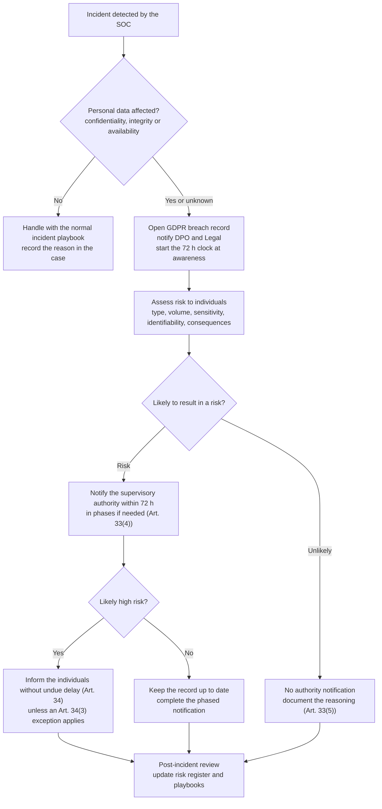

# GDPR Personal Data Breach Response

How a security incident becomes a GDPR personal data breach, who decides, what must be notified,
to whom, and by when. Companion to the [Data Breach playbook](../playbooks/data-breach-playbook.md)
and to risk scenario [R-04](../risk/incident-risk-scenarios.md).

**Author:** Omar Babba · **Status:** Living document · **Last updated:** 2026-10-09

> This document supports incident handling. It is not legal advice. Obligations depend on the
> organisation's role, the data involved and where the data subjects are. Involve the Data
> Protection Officer (DPO) and Legal as early as possible.

## Legal basis

| Reference | What it says | Why it matters here |
|---|---|---|
| GDPR Art. 4(12) | A *personal data breach* is a breach of security leading to accidental or unlawful destruction, loss, alteration, unauthorised disclosure of, or access to, personal data | Defines when an incident enters this procedure; covers confidentiality, integrity **and** availability |
| GDPR Art. 33(1) | The controller notifies the supervisory authority **without undue delay and, where feasible, within 72 hours** of becoming aware, unless the breach is unlikely to result in a risk to individuals' rights and freedoms | Starts the clock |
| GDPR Art. 33(2) | The **processor** notifies the controller without undue delay after becoming aware | Applies to suppliers and managed services |
| GDPR Art. 33(3) | Minimum content of the notification (see checklist below) | Drives the evidence the SOC must collect |
| GDPR Art. 33(4) | Information can be provided **in phases** when it is not all available | Notify on time with what is known, complete later |
| GDPR Art. 33(5) | The controller **documents every breach**, including facts, effects and remedial action, even when no notification is made | Requires the breach register below |
| GDPR Art. 34 | If the breach is likely to result in a **high risk**, individuals are informed without undue delay, in clear language; exceptions in Art. 34(3) (data unintelligible, for example strongly encrypted; subsequent measures remove the high risk; disproportionate effort, then public communication) | Second decision after the authority notification |
| GDPR Art. 32 | Security of processing appropriate to the risk | Used by the authority to judge whether controls were adequate |
| GDPR Art. 5(1)(f), 5(2) | Integrity and confidentiality principle; accountability | Evidence of decisions must be kept |
| GDPR Art. 83(4) | Failure to meet Art. 33 and 34 obligations can lead to fines up to EUR 10 million or 2 % of worldwide annual turnover, whichever is higher | Explains the weight given to the 72-hour rule |
| EDPB Guidelines 9/2022 | Practical guidance on breach notification, including when the controller is "aware" and how to assess risk | Basis for the decision workflow below |

For processing carried out in Morocco, Law 09-08 and the national data protection authority
(CNDP) apply, and the GDPR can apply in addition when the processing targets or monitors people
in the EU. Check the exact obligations and any local notification duty with Legal.

## Decision workflow

### When the 72 hours start

EDPB Guidelines 9/2022 consider the controller **aware** once it has a reasonable degree of
certainty that a security incident has compromised personal data. A short investigation to
establish that certainty is allowed, but it must start immediately, and the SOC timestamps the
moment awareness is reached in the case.

### Risk assessment factors

Use these to decide between "unlikely to result in a risk", "risk" and "high risk":

| Factor | Questions |
|---|---|
| Type of breach | Confidentiality (disclosure), integrity (alteration) or availability (loss)? |
| Nature, sensitivity, volume | Special categories (health, biometrics, beliefs)? Financial or identity data? How many records? |
| Ease of identification | Can individuals be identified directly? Is the data encrypted or pseudonymised, and is the key safe? |
| Severity of consequences | Fraud, identity theft, discrimination, loss of confidentiality, physical harm? |
| Individuals concerned | Children or vulnerable people? |
| Number of individuals | One person or thousands? |
| Controller characteristics | Role of the organisation (health, finance), reputation risk |

Record the factor-by-factor reasoning in the case. It is what the authority will ask for.

## Roles

| Role | Responsibility |
|---|---|
| SOC analyst | Detect, scope, collect evidence, timestamp awareness, open the breach record |
| SOC lead | Confirm severity, escalate to DPO and Legal, own the technical timeline |
| DPO | Lead the risk assessment, decide on notifications with Legal, contact the authority |
| Legal | Review wording, contracts with processors, local obligations |
| Communications | Prepare the message to individuals and the public if needed |
| Processor or supplier | Notify the controller without undue delay (Art. 33(2)) |

## Notification content checklist (Art. 33(3))

- [ ] Nature of the breach, with **categories and approximate number of individuals** and of records
- [ ] Name and contact details of the **DPO** or another contact point
- [ ] **Likely consequences** of the breach
- [ ] **Measures taken or proposed** to address the breach and reduce its effects
- [ ] If late, the **reasons for the delay**
- [ ] If phased, what is still unknown and when the next update is due

## Message to individuals (Art. 34(2))

Clear and plain language, covering at least: what happened, the DPO or contact point, likely
consequences, measures taken, and what individuals can do to protect themselves (for example
change a password, watch for fraud). Use the repo's
[stakeholder notification template](../templates/stakeholder-notification-template.md) as a base.

## Breach register (Art. 33(5))

Keep one entry for every breach, whether or not it was notified. A reusable template is in
[`breach-register-template.csv`](breach-register-template.csv). Minimum fields: breach ID, date
and time of awareness, description, categories and number of data subjects and records, likely
consequences, measures taken, notified to authority (yes or no, date, reference), reasoning if
not notified, individuals informed (yes or no, date), lessons learned.

## How this maps to the playbooks

| Playbook | When this procedure applies |
|---|---|
| [Data Breach](../playbooks/data-breach-playbook.md) | Always; this is the detailed procedure for its notification step |
| [Account Compromise](../playbooks/account-compromise-playbook.md) | If the compromised account gave access to personal data (mailbox, HR or customer systems) |
| [Phishing](../playbooks/phishing-incident-playbook.md) | If credentials were entered and the account holds personal data |
| [Malware Infection](../playbooks/malware-infection-playbook.md) | Ransomware or stealers: availability loss or exfiltration of personal data |
| [DDoS Attack](../playbooks/ddos-attack-playbook.md) | Usually not, unless the attack hides an intrusion or causes loss of availability of personal data |

## Evidence the SOC should capture for the 72-hour decision

- Time of first detection and time awareness was reached
- Systems and datasets touched, with log evidence of access or exfiltration
- Whether data was encrypted at rest and whether the keys were exposed
- Number and type of records, and the affected populations
- Containment actions with timestamps
- Chain of custody for collected evidence (see the
  [chain-of-custody template](../templates/chain-of-custody-template.md))

## Limits

This is a procedure template built from the public text of the GDPR and the EDPB guidance. It
has not been reviewed by a lawyer or applied to a real incident. Adapt thresholds, roles and
wording to the organisation and to local law.
