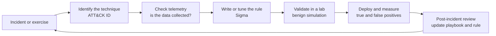

# MITRE ATT&CK Mapping and Detection Starting Points

Links each playbook to the adversary techniques it is meant to handle, the telemetry an analyst
needs to see them, and starter detections (Sigma) that can feed the playbook's Identification
phase.

**Author:** Omar Babba · **Status:** Living document · **Last updated:** 2026-10-09

Technique IDs refer to MITRE ATT&CK for Enterprise. Check the live framework before relying on an
ID, because techniques and sub-techniques are renamed and renumbered between releases.

## How to read this page

- **Techniques** are the behaviours the playbook expects to meet, not a complete list.
- **Telemetry** is what must be collected for the Identification phase to work.
- **Detections** point to the Sigma rules in [`sigma/`](sigma/), which are starting points to tune
  against the organisation's own logs and false positives.
- **Validation** lists how to test the detection safely, in an isolated lab, for example with
  Atomic Red Team.

## Phishing

| Tactic | Technique | ID | Telemetry |
|---|---|---|---|
| Initial Access | Phishing: Spearphishing Attachment | T1566.001 | Email gateway logs, message trace, endpoint process creation |
| Initial Access | Phishing: Spearphishing Link | T1566.002 | Email gateway, proxy and DNS logs, URL click-time protection |
| Reconnaissance | Phishing for Information | T1598 | Email gateway, user reports |
| Execution | User Execution: Malicious File | T1204.002 | Process creation (Sysmon event 1, Windows 4688) |
| Credential Access | Multi-Factor Authentication Request Generation | T1621 | Identity provider sign-in logs, MFA prompt counts |
| Credential Access | Steal Web Session Cookie | T1539 | Identity provider logs, impossible-travel and token-reuse signals |

- **Detections:** [Office spawning a script interpreter](sigma/office-spawns-script-interpreter.yml).
- **Validation:** open a benign macro document in a lab VM that launches `cmd.exe`, and confirm the
  rule fires and the alert carries the parent and child process.
- **Playbook link:** [Phishing](../playbooks/phishing-incident-playbook.md), Identification steps 3
  to 7 (detonate in a sandbox, find all recipients, classify interaction).

## Malware infection and ransomware

| Tactic | Technique | ID | Telemetry |
|---|---|---|---|
| Execution | Command and Scripting Interpreter: PowerShell | T1059.001 | PowerShell script block logging (4104), process creation |
| Persistence | Boot or Logon Autostart: Registry Run Keys | T1547.001 | Registry events (Sysmon 12, 13), autoruns |
| Persistence | Scheduled Task | T1053.005 | Windows 4698, Sysmon process creation |
| Defense Evasion | Process Injection | T1055 | Sysmon 8 and 10, EDR |
| Credential Access | OS Credential Dumping: LSASS Memory | T1003.001 | Sysmon 10 (process access), EDR |
| Lateral Movement | Remote Services: SMB/Windows Admin Shares | T1021.002 | Windows 4624 logon type 3, 5140 and 5145 share access |
| Defense Evasion | Indicator Removal: Clear Windows Event Logs | T1070.001 | Windows 1102 and 104 |
| Impact | Inhibit System Recovery | T1490 | Process creation (shadow copy and boot configuration commands) |
| Impact | Data Encrypted for Impact | T1486 | File-rename bursts, canary files, EDR ransomware heuristics |

- **Detections:** [Shadow copy deletion](sigma/shadow-copy-deletion.yml).
- **Validation:** Atomic Red Team provides tests for T1490, T1059.001 and T1547.001. Run them only
  on a disposable lab VM with no network, as in the author's
  [Digital Forensics Acquisition Lab](https://github.com/omarbabba779xx/digital-forensics-acquisition-lab).
- **Playbook link:** [Malware Infection](../playbooks/malware-infection-playbook.md),
  Containment (isolate the host, protect Tier-0 assets) and Recovery (tested backups).

## Account compromise

| Tactic | Technique | ID | Telemetry |
|---|---|---|---|
| Credential Access | Brute Force: Password Guessing, Spraying, Stuffing | T1110.001, T1110.003, T1110.004 | Windows 4625, identity provider sign-in failures |
| Initial Access | Valid Accounts | T1078 | Sign-in logs, impossible-travel, new device or location |
| Defense Evasion | Use Alternate Authentication Material: Web Session Cookie | T1550.004 | Token reuse from a new IP or user agent |
| Persistence | Account Manipulation | T1098 | Directory audit logs, role and credential changes |
| Collection | Email Collection: Email Forwarding Rule | T1114.003 | Exchange or Microsoft 365 audit (inbox rule creation) |
| Credential Access | Multi-Factor Authentication Request Generation | T1621 | MFA prompt volume per user |

- **Detections:** [Mailbox forwarding rule](sigma/m365-inbox-forwarding-rule.yml).
- **Validation:** create a forwarding rule on a test mailbox in a lab tenant and confirm the audit
  event reaches the SIEM with the fields the rule expects.
- **Playbook link:** [Account Compromise](../playbooks/account-compromise-playbook.md),
  Containment (revoke sessions and tokens, reset credentials, review mailbox rules).

## Data breach

| Tactic | Technique | ID | Telemetry |
|---|---|---|---|
| Collection | Data from Local System | T1005 | File access auditing, EDR |
| Collection | Data from Information Repositories | T1213 | SaaS and repository audit logs |
| Collection | Data from Cloud Storage | T1530 | Cloud storage access logs |
| Exfiltration | Exfiltration to Cloud Storage | T1567.002 | Proxy, DNS and process creation |
| Exfiltration | Exfiltration Over Alternative Protocol | T1048 | NetFlow, egress firewall logs |
| Exfiltration | Exfiltration Over C2 Channel | T1041 | Network detection, beacon analysis |
| Exfiltration | Transfer Data to Cloud Account | T1537 | Cloud audit logs |

- **Detections:** [Rclone execution](sigma/rclone-exfiltration-tool.yml).
- **Validation:** run `rclone` against a local test target on a lab host and check the alert and
  the evidence captured.
- **Playbook link:** [Data Breach](../playbooks/data-breach-playbook.md) and the
  [GDPR procedure](../compliance/gdpr-breach-response.md) for the notification decision.

## DDoS

| Tactic | Technique | ID | Telemetry |
|---|---|---|---|
| Impact | Network Denial of Service | T1498 | NetFlow, provider alerts, interface counters |
| Impact | Direct Network Flood | T1498.001 | Packets per second per source and per protocol |
| Impact | Reflection Amplification | T1498.002 | Spikes of UDP responses from DNS, NTP, memcached |
| Impact | Endpoint Denial of Service | T1499 | Application and server health metrics |
| Impact | Service Exhaustion Flood | T1499.002 | Connection tables, load balancer metrics |
| Impact | Application Exhaustion Flood | T1499.003 | Web server request rate, WAF logs |

- **Detections:** mostly threshold-based on network and application metrics rather than Sigma;
  see the [metrics guide](../metrics/ir-metrics.md) for the indicators to track.
- **Validation:** never test against production or third-party systems. Use a controlled
  load-testing tool against a staging service you own, with written approval.
- **Playbook link:** [DDoS Attack](../playbooks/ddos-attack-playbook.md).

## Detection engineering loop

A detection is finished only when it has a test, a known false-positive list and an owner. Rules
here are flagged `experimental` until they have been run against real telemetry.

## References

- MITRE ATT&CK for Enterprise: <https://attack.mitre.org/>
- Sigma rule specification: <https://sigmahq.io/docs/>
- Atomic Red Team: <https://github.com/redcanaryco/atomic-red-team>
- NIST SP 800-92, *Guide to Computer Security Log Management*
